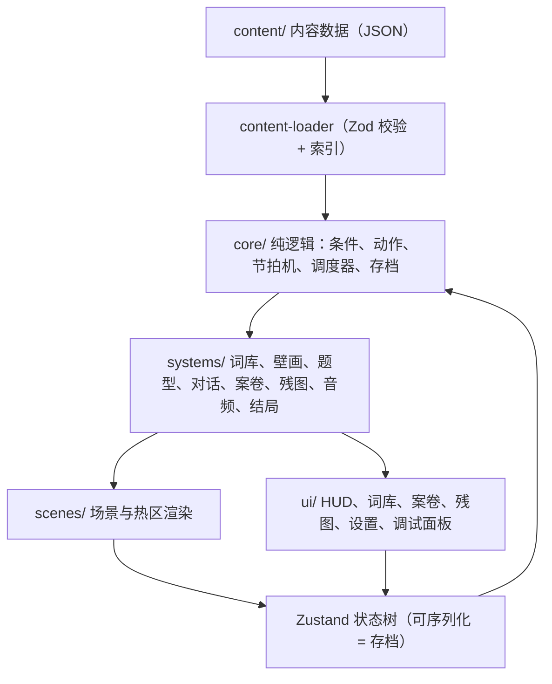

# 开发文档 · 奥德赛

> 把设计文档翻译成可执行的工程方案：技术选型、架构、数据模型、各系统规格、内容生产与核对流程、测试与里程碑。面向后续参与开发的工程师、内容编辑与技术美术。

**状态说明：** 标「建议」的是推荐方案，标「待确认」的需项目负责人拍板。设计依据见 [产品说明](01-产品说明.md)、[故事纲要](03-故事纲要.md)、[壁画视觉词典](04-壁画视觉词典-皮拉罕.md)、[主线剧本与世界观](05-主线剧本与世界观.md) 与 [各岛设计](islands/)。

## 1. 术语表

| 术语 | 含义 | 代码名 |
|------|------|--------|
| 词条 | 一个可学习的真实词或短语，含原文、转写、读音 | `Lexeme` |
| 教学义 | 设计用的中文标签，只在内部和调试中出现，不进教学 HUD | `gloss` |
| 概念 | 跨岛同义词条的归组，如「水」在五门语言里各一条 | `conceptId` |
| 热区 | 场景或壁画上可点的区域 | `Hotspot` |
| 核格 | 壁画中判定「学会」的那一格 | `CoreCell` |
| 题 | 一次可判定对错的交互单元 | `Puzzle` |
| 节拍 | 主线进度的一个节点（要水、要吃、离岛……） | `Beat` |
| 证物 | 案卷中的一枚记忆碎片 | `Evidence` |
| 案卷 | 证物收集界面 | `CaseFile` |
| 残图 | 航线地图，随通关点亮 | `ChartMap` |
| 残影词 | 新周目中保留但需复检一次的词 | `WordState = 'ghost'` |
| 母语白名单 | 允许出现玩家母语文字的界面位置 | `NativeTextWhitelist` |

## 2. 目标与范围

### MVP（第一个可交付版本）

- 序章 + 第一岛（皮拉罕）完整垂直切片：生存主线、壁画视觉词典五层、28 个教学词、3 枚证物、案卷、残图第一角、向导与离岛。
- Web 形态，桌面与手机浏览器都能玩；本地存档，无账号。
- 只做中文母语轨。

### 长期目标（已定）

先做 MVP，最终要上架。平台优先级：

| 优先级 | 平台 | 形态 |
|--------|------|------|
| 首要 | Web 端 | 浏览器直接玩，可安装为 PWA |
| 首要 | 手机端 iOS / Android | Capacitor 打包上架应用商店 |
| 后续可选 | Steam（桌面） | Electron 打包，手机与 Web 稳定后再评估 |
| 不考虑 | 主机 | — |

因此 MVP 虽然以 Web 形态交付，工程上从第一天就按「手机优先、可打包上架」来写：触屏优先、离线可玩、存储与平台功能走适配层、所有素材授权覆盖商业发行。上架路线见第 4 节。

### MVP 明确不做

- 第二岛及以后（只保留数据结构和题型接口）
- 账号、云存档、排行榜、内购
- 开麦发音评测（塔阿岛也只做可选彩蛋）
- 英语母语轨

## 3. 技术选型（已定：Web 技术栈，手机端与 Web 端优先）

选 Web 技术栈而不是 Godot 4 的原因：Web 端本身就是首要平台，同一份代码直接上线网页，再用 Capacitor 打成手机包；Godot 的网页导出包体大、在 iOS 浏览器上不稳定，与「Web 端优先」冲突。主机不在计划内，Web 技术栈做不了主机这一短板也就不构成问题。

| 领域 | 选择 | 理由 |
|------|------|------|
| 语言 | TypeScript（strict） | 数据模型多，类型能挡住大部分内容引用错误 |
| 构建 | Vite | 启动快，静态产物可直接托管 |
| UI | React 18 | 词库、案卷、契约板、积木拖拽都是 UI 密集型交互 |
| 状态 | Zustand + Immer | 存档就是一棵可序列化的状态树，切片清晰 |
| 场景渲染 | DOM + SVG 分层（背景图 + 多边形热区） | 游戏主体是点选式静态插画，不需要自由移动；SVG 热区在各种分辨率下都精确 |
| 动效 | CSS + Framer Motion | 苔藓剥落、核格放大、轻抖等都是 UI 级动效 |
| 音频 | Howler.js；节奏题用 Web Audio 时钟 | 听辨和节奏点按需要低延迟与精确计时 |
| 数据 | JSON 内容文件 + Zod 校验 | 内容与代码分离，编辑可以不碰代码 |
| 存档 | Web：IndexedDB（idb-keyval），失败回退 localStorage；手机：Capacitor Preferences / 文件存储 | 本地进度，容量足够；Web 端防丢档见第 10 节 |
| 离线与安装 | vite-plugin-pwa（Service Worker + Web App Manifest） | Web 端可离线、可添加到主屏幕 |
| 手机打包 | Capacitor | 复用同一份 Web 构建 |
| 测试 | Vitest + Testing Library + Playwright | 单元、组件、端到端 |
| 规范 | ESLint + Prettier | — |
| 包管理 | pnpm | — |
| 部署 | Web：静态托管（GitHub Pages / Vercel / Cloudflare Pages 任一）；手机：见第 4 节 | 同一份 Web 构建产物供网页和手机包使用 |

**备选与兜底：**

- 将来需要角色自由走动、粒子或大量动画时，在场景层引入 PixiJS，UI 层仍用 React。
- 手机端音频延迟不达标时，先在手机包里改用原生音频插件（如 `@capacitor-community/native-audio`）播放听辨与节奏题音效，Web 端保留 Web Audio。
- 只有在上述兜底后手机端仍不达标时，才评估切换 Godot 4；但那会牺牲 Web 端体验，需重新权衡平台优先级。本文档的数据模型、内容格式和系统划分不依赖 React，可以平移。

## 4. 上架路线

### 4.1 打包方式（建议）

| 目标平台 | 优先级 | 打包方式 | 平台功能接入 |
|----------|--------|----------|--------------|
| Web 端 | 首要 | 静态部署 + PWA | 离线缓存、添加到主屏幕、持久化存储申请 |
| iOS / Android | 首要 | Capacitor 包装 Web 构建 | 原生存储、iCloud / Google 备份、触感反馈、切后台暂停、安卓返回键 |
| Steam（桌面） | 后续可选 | Electron 包装 Web 构建 | steamworks.js：成就、Steam 云存档 |

Steam 选 Electron 而不是 Tauri，是因为 Steamworks 在 Electron 上有现成的绑定，并且各平台渲染内核一致。手机与 Web 稳定前不投入 Steam 打包。

### 4.2 从 MVP 起就要遵守的约束

| 约束 | 原因 | 落到哪里 |
|------|------|----------|
| 离线可玩，所有素材随包分发，不依赖 CDN | 商店版本必须离线运行；Web 端靠 Service Worker 缓存 | 资源加载器只读相对路径 |
| 存储走 `StorageAdapter` 接口 | Web 用 IndexedDB，手机用原生存储，日后 Steam 用本地文件 + 云存档 | `core/save/` |
| 平台功能走 `PlatformAdapter` 接口 | 震动、切后台暂停、返回键、成就因平台而异；Web 版给空实现 | `src/platform/` |
| 触屏优先，输入不依赖悬停 | 手机是首要平台；所有交互先在手机上设计，再适配鼠标 | 热区组件、设置 |
| 热区与按钮最小触控尺寸 | 小屏上误触会直接破坏「点核格」的判定体验 | 热区组件按屏幕物理尺寸放大判定区 |
| 屏幕方向与安全区 | 刘海屏、圆角、横竖屏切换 | 场景容器；方向待确认（第 18 节） |
| 资源体积预算 | 手机流量与内存有限 | 按岛分包；单岛首包体积设上限，内容校验报表统计 |
| 素材授权覆盖**商业发行** | 语言档案的录音常只授权非商业用途 | 内容核对流程（第 11.2 节） |
| 字体可商用并允许嵌入 | Ethiopic 与加拿大原住民音节文字字体需随包分发 | 用 SIL OFL 授权的 Noto 系列 |
| 不在包内留调试面板 | 商店审核与防剧透 | 构建时剔除 `src/dev/` |

### 4.3 上架技术验证

M1 完成后先做一次上架技术验证，再铺后续岛的内容：

1. 把第一岛打成 iOS 测试包（TestFlight）和 Android 测试包，同时上线 PWA 版。
2. 在低端与中端安卓机、较旧的 iPhone、iOS Safari 和安卓 Chrome 上检查帧率、启动时间、内存、音频延迟、存档读写与触控误触率。
3. 用一个塔阿岛节奏题原型专门测音频延迟（第二岛最依赖时序，必须在 M2 前验证）。
4. 验证 Web 端离线游玩、添加到主屏幕、长时间不打开后存档仍在。
5. 不达标时按第 3 节的兜底顺序处理。

### 4.4 上架前清单

- 商店素材：App Store / Google Play 图标、各尺寸截图、预告片、商店文案（多语言）
- 苹果审核：内容全部随包、离线可玩，避免被判为「套壳网页」
- 隐私政策（即使不收集数据，移动商店也要求填写）
- 年龄分级问卷
- 第三方授权清单：录音、字体、开源库
- 文化与语言审读记录（见第 11.4 节）
- 商业模式对应的接入（买断、免费试玩加解锁或其他，待确认）

## 5. 总体架构



分层规则：

1. `core/` 只写纯 TypeScript，不引入 React 或浏览器 API，保证可单元测试。
2. 所有进度变化都通过 `core` 的 **动作（Action）** 执行，UI 不直接改状态。这样调试面板、自动化测试和真实玩家走的是同一条路径。
3. 内容只通过 ID 引用彼此；加载时建索引并校验所有引用都存在。
4. 业务代码不得直接调用 IndexedDB、Steamworks 或 Capacitor 插件，一律经过 `src/platform/` 的适配层。

## 6. 目录结构（建议）

应用代码放在仓库根目录，与 `docs/` 并列：

```
odyssey_game/
├── docs/                      设计与开发文档
├── content/                   内容数据（编辑主要改这里）
│   ├── shared/
│   │   ├── concepts.json      跨岛概念
│   │   ├── evidence.json      15 枚证物 + 周目证物
│   │   ├── whispers.json      低语线
│   │   └── endings.json       结局条件
│   ├── islands/
│   │   └── myp/               皮拉罕岛（ISO 639-3 代码）
│   │       ├── lexemes.json
│   │       ├── scenes.json
│   │       ├── murals.json
│   │       ├── puzzles.json
│   │       ├── dialogue.json
│   │       └── beats.json
│   └── locales/
│       └── zh-CN.json         仅母语白名单内的文本
├── public/assets/             图片与音频（按岛分目录）
├── src/
│   ├── core/                  conditions / actions / beats / scheduler / save
│   ├── content-loader/
│   ├── systems/
│   │   ├── lexicon/
│   │   ├── mural/
│   │   ├── puzzles/           每个题型一个子目录 + registry.ts
│   │   ├── dialogue/
│   │   ├── casefile/
│   │   ├── chart/
│   │   ├── audio/
│   │   └── finale/
│   ├── scenes/
│   ├── ui/
│   ├── platform/              PlatformAdapter / StorageAdapter：web、steam、mobile 三份实现
│   └── dev/                   调试面板、热区编辑器（生产构建剔除）
├── platforms/
│   ├── capacitor/             iOS / Android 工程（M1.5 起）
│   └── electron/              Steam 打包（后续可选，手机与 Web 稳定后再建）
├── tools/                     内容校验、报表脚本
└── tests/e2e/
```

## 7. ID 规范

格式：`<岛代码>.<类型>.<短名>`，全部小写，短名用连字符。

| 岛代码 | 含义 |
|--------|------|
| `pro` | 序章 |
| `myp` | 皮拉罕岛（Pirahã） |
| `nmn` | 塔阿岛（Taa / ǃXóõ） |
| `amh` | 阿姆哈拉岛 |
| `iku` | 因纽特岛（Inuktitut） |
| `eus` | 巴斯克赛博岛 |
| `fin` | 终局镜厅 |

| 类型 | 示例 |
|------|------|
| `word` | `myp.word.water` |
| `scene` | `myp.scene.shore` |
| `hs` | `myp.hs.shore-stone` |
| `mural` / `band` / `panel` / `cell` | `myp.cell.betrayal-taker` |
| `pz` | `myp.pz.share-fish` |
| `npc` | `myp.npc.guide` |
| `line` | `myp.line.guide-farewell` |
| `beat` | `myp.beat.water` |
| `ev` | `myp.ev.a` / `myp.ev.b` / `myp.ev.main` |
| `flag` | `amh.flag.faction` |
| 概念 | `concept.water` |

证物与《主线剧本》编号对照：1-A = `myp.ev.a`，1-M = `myp.ev.main`，以此类推。

## 8. 数据模型

以下为 TypeScript 形态；实际以 Zod schema 为准，类型由 `z.infer` 导出。

### 8.1 词条

```ts
type IslandId = 'myp' | 'nmn' | 'amh' | 'iku' | 'eus';

type LexemeLayer =
  | 'concrete' | 'action' | 'relation' | 'abstract'   // 五岛通用
  | 'listening'                                      // 塔阿：听辨
  | 'script'                                         // 阿姆哈拉、因纽特：字符/音节
  | 'compound'                                       // 因纽特：长词模板
  | 'structure'                                      // 巴斯克：作格槽位
  | 'finale';                                        // 终局抉择词

interface Lexeme {
  id: string;
  island: IslandId;
  layer: LexemeLayer;
  gloss: string;                 // 教学义，仅内部使用
  conceptId?: string;            // 跨岛对照
  forms: {
    native?: string;             // 原文字：Fidel、音节文字或拉丁字母
    translit?: string;           // 拉丁转写
    ipa?: string;
  };
  audio: string[];               // 音频资源 ID，可多条录音
  visual: string;                // 玩家词库里代表「义」的图像（通常是核格裁图）
  requires: string[];            // 依赖词，未学会时相关壁画格保持模糊
  inLexicon: boolean;            // 罪证用的「断」等为 false
  verification: {
    status: 'draft' | 'sourced' | 'reviewed' | 'recorded';
    sources: string[];           // 词典、论文、档案条目
    reviewer?: string;
    notes?: string;              // 如「真实语言无单独词，改为场景短语」
  };
}
```

示例（皮拉罕原文待核对，故留空，状态为 `draft`）：

```json
{
  "id": "myp.word.water",
  "island": "myp",
  "layer": "concrete",
  "gloss": "水",
  "conceptId": "concept.water",
  "forms": {},
  "audio": [],
  "visual": "myp/cells/water.webp",
  "requires": [],
  "inLexicon": true,
  "verification": { "status": "draft", "sources": [] }
}
```

### 8.2 玩家的词条进度

```ts
type WordState = 'unseen' | 'seen' | 'guessed' | 'learned' | 'mastered' | 'ghost';

interface WordProgress {
  id: string;
  state: WordState;
  box: 1 | 2 | 3 | 4;           // 复现调度用的盒子等级
  correct: number;
  wrong: number;
  lastReviewStep?: number;       // 以「完成的题数」计步，不用真实时间
}
```

状态迁移：

| 从 | 到 | 触发 |
|----|----|------|
| unseen | seen | 热区第一次出现，或第一次听到该词 |
| seen | guessed | 玩家做出一次配对尝试 |
| guessed | learned | 验证通过（壁画核格 + 实物对照，或动作验证） |
| learned | mastered | 复用检验通过（第二面墙、夜景版或换角色重画） |
| mastered | ghost | 进入新周目 |
| ghost | learned | 新周目中正确使用一次 |

答错只让 `box` 降一级，不回退 `state`，不扣任何资源。

### 8.3 场景与热区

坐标一律用相对背景图的 0–1 归一化值，适配任意分辨率。

```ts
type Shape =
  | { type: 'polygon'; points: [number, number][] }
  | { type: 'rect'; x: number; y: number; w: number; h: number };

interface Hotspot {
  id: string;
  shape: Shape;
  visibleWhen?: Condition;
  enabledWhen?: Condition;
  onActivate: Action[];
  longPress?: Action[];          // 凝视：长按放大
  affinityGlow?: Condition;      // 满足时亮起，降低难度
}

interface Scene {
  id: string;
  island: IslandId | 'pro' | 'fin';
  background: string;
  overlays?: { id: string; image: string; visibleWhen?: Condition }[];
  hotspots: Hotspot[];
  music?: string;
  ambience?: string;
}
```

### 8.4 壁画

结构对应《壁画视觉词典》：墙 → 带（层）→ 格 → 核格。

```ts
interface Mural {
  id: string;
  scene: string;
  bands: MuralBand[];
}

interface MuralBand {
  id: string;
  layer: LexemeLayer;
  unlockWhen: Condition;         // 例：具体词 >= 6
  reveal: 'moss' | 'paint' | 'night';
  panels: MuralPanel[];
}

interface MuralPanel {
  id: string;
  image: string;
  blurUnless?: Condition;        // 依赖词未齐时模糊
  cells: CoreCell[];
}

interface CoreCell {
  id: string;
  shape: Shape;
  teaches?: string;              // 词条 ID
  evidence?: string;             // 罪证热区：证物 ID
  pickableWhen?: Condition;      // 罪证格需先学会特定词
  verifyWith?: {                 // 「对照」：点核格后还要点实物或做动作
    item?: string;
    action?: string;
  };
}
```

### 8.5 条件

条件是可序列化的 JSON 树，由 `core/conditions.ts` 统一求值。

```ts
type Condition =
  | { all: Condition[] }
  | { any: Condition[] }
  | { not: Condition }
  | { flag: string; eq?: boolean | number | string }
  | { word: string; atLeast: WordState }
  | { layerCount: { island: IslandId; layer: LexemeLayer; atLeast: WordState; min: number } }
  | { beatDone: string }
  | { evidence: string }
  | { evidenceCount: { min: number; requireAllMain?: boolean } }
  | { holding: string }            // 身上有某实物
  | { recentAction: string };      // 刚对 NPC 做过的动作
```

示例：壁画「动作层」解锁条件（具体词至少 6 个）：

```json
{ "layerCount": { "island": "myp", "layer": "concrete", "atLeast": "learned", "min": 6 } }
```

### 8.6 动作

```ts
type Action =
  | { setFlag: string; value?: boolean | number | string }
  | { markSeen: string }
  | { learnWord: string }
  | { collectEvidence: string }
  | { completeBeat: string }
  | { goto: string; transition?: 'fade' | 'tide' | 'storm' }
  | { startPuzzle: string }
  | { playDialogue: string }
  | { playCutscene: string }
  | { playWhisper: number }
  | { revealChart: string }
  | { giveItem: string }
  | { sfx: string };
```

### 8.7 题

```ts
type PuzzleType =
  | 'pair-match'          // 指物配对（岛 1）
  | 'action-verify'       // 对 NPC 做对动作（岛 1）
  | 'mural-cell'          // 壁画核格点选（岛 1，终局）
  | 'sound-match'         // 声纹听辨、最小对立（岛 2）
  | 'rhythm-tap'          // 鼓点节奏（岛 2）
  | 'glyph-assemble'      // Fidel 基字 + 元音形拼词（岛 3）
  | 'contract-fill'       // 契约板短句填空（岛 3）
  | 'syllabic-blocks'     // 音节积木，旋转换元音（岛 4）
  | 'word-builder'        // 多式综合长词模板（岛 4）
  | 'ergative-slots'      // 作格色标填槽（岛 5）
  | 'finale-round';       // 终局回合包装器

interface PuzzleBase {
  id: string;
  type: PuzzleType;
  island: IslandId | 'fin';
  teaches: string[];             // 本题新教的词
  reviewSlots?: number;          // 允许调度器塞入多少个复习词
  timeLimitMs?: number;          // 塔阿「沉默过久关闭交易」
  onPass: Action[];
  onFail?: Action[];             // 终局：重播相关证物
  config: unknown;               // 各题型自己的 schema
}
```

题型以插件方式注册：每个题型目录导出 `schema`（Zod）、`Component`（React）与 `judge(config, input)`（纯函数，可单测）。

### 8.8 节拍（主线进度）

每岛主线是一串有序节拍，节拍机负责「条件满足 → 执行动作 → 推进」。

```ts
interface Beat {
  id: string;
  island: IslandId | 'pro' | 'fin';
  order: number;
  completeWhen: Condition;
  onComplete: Action[];
  optional?: boolean;            // 支线节拍
}
```

第一岛主线节拍（对应岛设计「节拍细化」）：`pro.beat.storm` → `myp.beat.water` → `myp.beat.food` → `myp.beat.sleep` → `myp.beat.danger` → `myp.beat.abstract-open` → `myp.beat.old-layer`（可漏）→ `myp.beat.depart`。

### 8.9 对话

NPC 说的话由词元组成。已学会的词显示玩家词库里的图像，未学会的只显示原文与声纹，不出现母语翻译。

```ts
type Token =
  | { word: string }                          // 引用词条
  | { raw: { native?: string; translit?: string } }  // 未入词库的片段
  | { gesture: string }                       // 手势动画
  | { pause: number };

interface DialogueLine {
  id: string;
  speaker: string;
  tokens: Token[];
  audio?: string;
  showWhen?: Condition;
}
```

### 8.10 证物与结局

```ts
interface Evidence {
  id: string;                    // myp.ev.main
  island: IslandId;
  kind: 'main' | 'side' | 'ng';
  labelKey: string;              // zh-CN.json 中的案卷标签（母语白名单）
  cutscene: string;
  skippable: boolean;            // 序章 1-A 与 5-M 为 false
}

interface EndingRule {
  id: 'false-home' | 'new-interpreter' | 'forget-again';
  when: Condition;               // 结合 evidenceCount 与终局抉择 flag
}
```

终局判定按《主线剧本》第八节的顺序执行，阈值放在 `endings.json`，便于调参。

## 9. 系统规格

### 9.1 母语白名单

只有下列位置允许出现玩家母语文字，其余一律用图像、原文、声纹与手势：

1. 案卷证物标签
2. 低语字幕
3. 系统菜单、设置、存档界面
4. 片头片尾字幕
5. 调试面板（生产构建剔除）

实现方式：母语文本只存在于 `content/locales/zh-CN.json`，只有白名单内的组件能调用 `t()`。内容校验脚本检查对话、壁画、题目配置中不得出现中文字符（`gloss` 字段除外）。

### 9.2 场景与热区

- 热区默认不可见；进入触发区后才显示可点提示，且先不显示词义。
- 点错只做轻抖，不扣任何资源。
- 长按（默认 400 ms，可在设置里调）进入凝视放大；左右滑查看多格。
- 鼠标与触摸同等支持，不依赖悬停。

### 9.3 词库

- 每个词条卡片显示：玩家的「义」图（核格裁图）、原文、转写、播放按钮。
- **五语对照页**：按 `conceptId` 排列，五岛同一概念并排，学到一门点亮一格。这是「缝合群岛」在 UI 上的直接体现，终局后记会调用它。
- 是否提供「显示教学义」的无障碍开关：待确认（见第 18 节）。

### 9.4 复现调度器

游戏不是每日打卡制，所以调度按「完成题数」计步，不按真实时间。

- 盒子 1–4，对应复习间隔 2 / 5 / 12 / 30 步（初始值，可调）。
- 题目声明 `reviewSlots` 后，调度器从到期词中挑选，优先选当前岛的词，其次选前一岛的词。
- 答对升一盒，答错降一盒。
- **航行插曲（建议，待确认）：** 两岛之间的航行段做成一组短复习：用记得的词点亮残图上的航标，以此兑现「通关亮航线下一格」，也让旧岛词自然复现。

### 9.5 壁画系统

实现《壁画视觉词典》的全部交互：

| 需求 | 实现要点 |
|------|----------|
| 层锁 | `MuralBand.unlockWhen`；解锁时播放苔藓剥落或加色动画 |
| 依赖未齐时模糊 | `MuralPanel.blurUnless`；用 CSS blur，不能只靠透明度 |
| 对照降难度 | `Hotspot.affinityGlow` 结合 `holding` / `recentAction` 条件 |
| 复用检验 | 第二面墙用不同 panel 引用同一 `teaches`，通过后 `learned → mastered` |
| 罪证热区 | `CoreCell.evidence` + `pickableWhen`；不进词库，可漏 |
| 已学弱光 | 已学会的核格渲染弱光轮廓 |

### 9.6 题型模块

| 题型 | 岛 | 输入 | 判定 | 关键技术点 |
|------|----|------|------|------------|
| pair-match | 1 | 点壁画 + 点实物 | 两次点选属于同一词条 | 配对状态需在两次点击间保持 |
| action-verify | 1 | 从动作盘选动作作用于 NPC | 动作与 NPC 期望一致 | NPC 期望由对话词元表达 |
| mural-cell | 1、终 | 点核格 | 命中正确多边形 | 多边形命中检测，缩放后坐标换算 |
| sound-match | 2 | 听音后点声纹符 | 与目标音一致 | 最小对立对；可重复播放 |
| rhythm-tap | 2 | 按节奏点按 | 时序误差在容差内 | Web Audio 时钟；设置里提供延迟校准与宽容度 |
| glyph-assemble | 3 | 拖基字，再选元音形 | 序列与目标一致 | 需要支持 Ethiopic 字体（如 Noto Sans Ethiopic） |
| contract-fill | 3 | 拖词入槽 | 槽位全部正确 | 错误时播放「板裂」动画，整板重来 |
| syllabic-blocks | 4 | 拖块、旋转 | 形状与朝向一致 | 旋转即换元音；需 Canadian Aboriginal Syllabics 字体（如 Noto Sans Canadian Aboriginal） |
| word-builder | 4 | 按颜色模块拼长词 | 模块序列与模板一致 | 3–5 个模板；整词播放时波形与模块同步高亮 |
| ergative-slots | 5 | 拖词入施事/受影响者槽 | 槽位与格标记一致 | 色标 + 形状双编码（色盲友好） |
| finale-round | 终 | 包装上述题型 | 子题通过 | 失败动作为重播证物 |

### 9.7 案卷

- 外观像裂开的海图残片与烧焦录音条；15 个槽位，未得的显示裂缝轮廓（新周目显示上一周目的虚线轮廓）。
- 获得证物时播放无旁白短过场，再落到案卷，标签以母语显示。
- 案卷只展示，不提供兑换或升级。

### 9.8 残图（双生地图）

- 一张图分两层：地理层（景物、航线）与词库层（每座岛的五语对照完成度）。
- 离岛时点亮下一格；第五岛揭示旧中继网络的连线，结局 B 把「断线」渲染成「缝线」。

### 9.9 音频

- 搭嘴音、声调、长词整段播放对音质要求高：母带 48 kHz / 24 bit WAV，发布用 OGG，另导 MP3 或 AAC 兼容 Safari。
- 响度统一到约 -16 LUFS；文件名与词条 ID 一致，如 `myp.word.water.take1.ogg`。
- 首次交互后再初始化音频上下文（浏览器自动播放限制）；iOS 静音键打开时网页音频可能无声，开场需提示玩家。
- 手机包内听辨与节奏题如延迟不达标，切换到原生音频插件（见第 3 节兜底）。

### 9.10 终局与新周目

- 终局五回合由 `finale-round` 包装各岛题型，配置引用前五岛的词条 ID。
- 若玩家某岛词库不完整，回合内只使用其已学会的词，并保证存在可通过的最小解。
- 新周目：`mastered → ghost`；向导首句、序章低语、漂木堆船板根据 `ngCount > 0` 切换。

### 9.11 设置与无障碍

| 项 | 说明 |
|----|------|
| 色盲模式 | 作格色标、热区高亮同时用形状区分 |
| 减少动效 | 关闭剥落、震屏、风暴闪烁 |
| 字号 | 原文与转写可放大 |
| 长按时长 | 200–800 ms 可调 |
| 节奏宽容度 | 三档 |
| 听辨视觉替代 | 声纹符始终可见，不做纯听力硬门 |
| 开麦 | 只做可选彩蛋，默认关闭 |

## 10. 存档

```ts
interface SaveData {
  version: number;
  createdAt: string;
  updatedAt: string;
  ngCount: number;
  currentScene: string;
  beats: Record<string, boolean>;
  flags: Record<string, boolean | number | string>;
  words: Record<string, WordProgress>;
  evidence: string[];
  inventory: string[];
  chart: string[];
  whispersHeard: number;
  stepCounter: number;           // 复现调度用
  settings: Settings;
}
```

- 自动存档时机：节拍完成、获得证物、切换场景。
- MVP 只做一个存档槽，外加新周目继承数据。
- 读写只经过 `StorageAdapter`（`load / save / list / remove`），Web、手机端各一份实现（日后 Steam 再加一份）；存档序列化为单个 JSON，便于接入云存档与移动端备份。
- **Web 端防丢档：** Safari 会清理长时间未访问网站的本地数据。应对：启动时调用 `navigator.storage.persist()` 申请持久化；引导玩家把游戏添加到主屏幕（PWA）；设置里提供「导出 / 导入存档」（存档 JSON 压缩成一段文本或文件）。
- `version` 递增时在 `core/save/migrations.ts` 写迁移函数，读档时依次执行；附带单元测试。

## 11. 内容生产流程

### 11.1 词条核对（最重要）

本项目承诺「真拼写、真读音、真常用义」，所以每个词条都要经过以下状态：

| 状态 | 含义 | 谁负责 |
|------|------|--------|
| draft | 只有教学义，原文未定 | 设计 |
| sourced | 已从词典、论文或语言档案找到原文与出处 | 内容编辑 |
| reviewed | 语言顾问或母语者确认拼写、读音与用法 | 语言顾问 |
| recorded | 已有授权录音 | 音频 |

规则：

1. 正式构建中，`inLexicon: true` 且所属岛已上线的词条必须达到 `reviewed`，否则 CI 失败。
2. 开发构建允许 `draft`，界面上用占位图标标出。
3. 若某教学义在真实语言里没有单独的词（如皮拉罕的部分抽象义），在 `notes` 写明「改为场景短语」，并把 `forms` 填为短语。
4. 有争议的语言学结论只在 `notes` 中记录，不写进游戏文本。

### 11.2 录音来源

| 语言 | 可行来源（需逐一确认许可） | 风险 |
|------|----------------------------|------|
| 皮拉罕语 | 语言档案库中的田野录音；研究者合作 | 使用者很少，录音稀缺，**MVP 最大的内容风险** |
| 塔阿语 | 语言档案库；研究机构合作 | 搭嘴音录音质量要求高 |
| 阿姆哈拉语 | 母语者录制（较易找到） | 低 |
| 因纽特语 | 母语者或社区机构合作 | 需文化顾问参与 |
| 巴斯克语 | 母语者录制（较易找到） | 低 |

TTS 只能用于开发期占位，不进正式版。录音须有书面授权，注明署名方式。

因为最终要上架，授权必须明确覆盖**商业发行**与**随包分发**。很多语言档案只允许非商业或学术使用，这类素材只能作研究参考，不能直接进游戏包。每条录音在内容数据里记录授权编号，CI 对正式构建检查授权字段非空。

### 11.3 美术

- 基准画布 1920 × 1080（16:9）。手机是首要平台，建议**锁定横屏**，壁画与场景完整呈现；若坚持竖屏，需改为纵向构图或横向平移浏览，美术规范要重写（待确认）。
- 手机端按设备像素比加载 @1x 或 @2x，避免低端机内存溢出。
- 壁画分层导出 WebP @1x/@2x：底层、苔藓层、颜料层、夜景层、模糊版。
- 热区多边形用调试面板中的热区编辑器在实际图上绘制，导出为 JSON 写回 `scenes.json` / `murals.json`。

### 11.4 文化审读

涉及圣地、命名传统、受害者叙事的内容（见《主线剧本》第十一节），在 `reviewed` 之外还需文化审读通过，审读记录写在对应内容条目的 `notes` 中。

## 12. 开发工具

| 工具 | 作用 |
|------|------|
| 调试面板 | 跳场景、设 flag、解锁词条或证物、显示热区轮廓、节奏题慢放、切换新周目 |
| 热区编辑器 | 在背景图上点多边形，导出归一化坐标 |
| `pnpm content:check` | Zod 校验；悬空引用；`requires` 循环依赖；无法到达的核格；母语白名单违规；核对状态报表 |
| `pnpm content:graph` | 把节拍与条件导出为 mermaid 流程图，便于设计评审 |

## 13. 测试

### 13.1 单元测试

条件求值、动作执行、节拍机、复现调度器、结局判定、存档迁移、各题型的 `judge` 函数。

### 13.2 内容可达性测试

用纯逻辑「自动玩家」在不渲染 UI 的情况下跑两条路径：

- **黄金路径**：拿全所有证物，验证每个证物都能拿到。
- **最短路径**：跳过所有可漏内容，验证仍能离岛。这条对应设计中反复出现的「罪证可漏、不卡主线」。

### 13.3 端到端测试（Playwright）

序章到第一岛离岛，在桌面视口和手机视口各跑一遍。

### 13.4 验收清单映射

| 设计验收项 | 测试方式 |
|------------|----------|
| 不靠母语完成存活与至少 10 词 | 内容校验（白名单） + 端到端 |
| 抽象层依赖具体词 | 单元测试：`blurUnless` 条件 + 内容可达性 |
| 罪证可漏、不卡主线 | 内容可达性最短路径 |
| 至少 12 个抽象相关义有核格并有复用检验墙 | 内容校验报表 |
| 离岛深化条件：抽象层含饥饿、承诺、危险 | 单元测试：`myp.beat.depart` 条件 |
| 终局所需的背叛、谎言、信任、分享、原谅在主线必学 | 内容可达性最短路径中检查这五词为 learned |

### 13.5 试玩测试

每个里程碑结束时做一轮：记录首次学会一个词所需时间、卡关点、流失点；试玩结束 24 小时后做一次不看画面的回忆小测，衡量是否「带走真词」。

## 14. 里程碑

只描述交付内容与退出条件，不估算日历时间。

| 里程碑 | 交付 | 退出条件 | 主要风险 |
|--------|------|----------|----------|
| M0 技术原型 | 工程骨架、一个场景、热区、pair-match、词库最小版、存档 | 能学会 3 个词，刷新页面后进度仍在 | 无 |
| M1 第一岛垂直切片（MVP） | 序章、第一岛 6 个场景、28 词、壁画五层、3 枚证物、案卷、残图第一角、向导与离岛、调试面板与内容校验 | 第一岛与壁画视觉词典两份验收清单全部通过；内容可达性测试通过；完成一轮试玩 | 皮拉罕词条核对与录音 |
| M1.5 手机与 Web 上架技术验证 | 第一岛的 iOS / Android 测试包与 PWA 版；塔阿节奏题延迟原型 | 第 4.3 节各项在目标设备上达标；否则按第 3 节兜底顺序处理 | 手机端音频延迟；低端安卓内存 |
| M2 塔阿岛 | sound-match、rhythm-tap、延迟校准、沉默计时、航行插曲 | 塔阿验收清单通过；节奏题在手机上误判率可接受 | 音频延迟；搭嘴音素材 |
| M3 阿姆哈拉岛 | glyph-assemble、contract-fill、两派 flag | 阿姆哈拉验收清单通过 | Ethiopic 字体渲染 |
| M4 因纽特岛 | syllabic-blocks、word-builder、方位导航翻转 | 因纽特验收清单通过 | 文化审读 |
| M5 巴斯克岛与终局 | ergative-slots、核验塔、finale-round、三结局、新周目 | 巴斯克验收清单通过；三结局都可达成 | 终局对旧岛词的组合测试量大 |
| M6 打磨 | 无障碍、性能、音频统一、文化审读收尾 | 全部内容达到 `reviewed`；端到端全绿 | — |
| M7 上架 | 第 4.4 节上架前清单全部完成；Web 正式版上线，App Store 与 Google Play 提审 | 通过商店审核 | 审核意见返工 |
| M8 Steam（可选） | Electron 打包、steamworks.js 接入成就与云存档 | 通过 Steam 审核 | 视手机与 Web 表现再决定是否启动 |

## 15. 工程规范

- TypeScript `strict`，禁止 `any`；内容类型一律来自 Zod schema。
- `core/` 不得导入 React 或 `window`（ESLint 导入限制规则）。
- 分支：`feature/<岛代码>-<主题>`、`content/<岛代码>-<主题>`、`fix/<主题>`。
- 提交信息用 Conventional Commits，并增加 `content:` 类型，例如 `content(myp): add mural abstract band`。
- 合并前必须通过 `pnpm lint && pnpm typecheck && pnpm test && pnpm content:check`，由 CI（GitHub Actions）执行。
- 内容改动的 PR 描述里需列出变更的词条 ID 与核对状态。

## 16. 性能与平台目标

- 浏览器（MVP 与网页试玩）：桌面 Chrome、Safari、Firefox 最新两个大版本；iOS Safari 16+；Android Chrome。
- 手机包：iOS（版本下限待定，建议 iOS 16+）、Android（建议 Android 9+）。Steam 为后续可选，主机不考虑。
- 设计基准机型：低端安卓机可玩，中端手机流畅（目标 60 fps）。
- 按岛懒加载资源，首屏只加载序章与第一岛；上架包内资源全部随包分发。

## 17. 风险

| 风险 | 影响 | 应对 |
|------|------|------|
| 皮拉罕语资料与录音稀缺 | MVP 内容无法达到 `reviewed` | 尽早联系研究者与语言档案；备选是 MVP 换一门资料充足的语言先验证玩法（待确认） |
| 真实族群的文化表达 | 口碑与伦理风险 | 虚构族群原则 + 文化审读流程 |
| 有争议的语言学结论 | 被批评不严谨 | 只演不断言；`notes` 记录出处 |
| 终局组合爆炸 | 测试成本高 | 回合只用已学词，并做最小解校验 |
| 母语泄漏 | 违背核心设计 | 白名单 + 内容校验自动拦截 |
| 素材授权不覆盖商业发行 | 上架时被迫替换录音 | 从 M1 起记录授权编号，CI 检查；只采用可商用授权 |
| 手机端网页内核的音频延迟与性能不足 | 塔阿岛体验差，低端机卡顿 | M1.5 实机验证；延迟校准 + 宽容度设置 + 视觉替代；原生音频插件兜底；资源按设备分辨率加载 |
| Web 端本地存档被浏览器清理 | 玩家丢档 | 申请持久化存储、引导安装 PWA、提供存档导出导入 |

## 18. 待确认问题

已定：Web 技术栈；手机端与 Web 端优先，Steam 后续可选，主机不考虑（见第 2–4 节）。仍待确认：

1. **商业模式与屏幕方向**：买断、免费试玩加解锁，还是其他？手机端锁定横屏是否可以？
2. **MVP 词量**：产品说明写 50–80 词，第一岛设计是 28 词。MVP 只做第一岛（28 词），还是做前两岛凑到约 56 词？
3. **皮拉罕作为第一岛的资料风险**：是否接受「先用占位内容做玩法，再补核对」，还是考虑调整首岛语言？
4. **词库是否显示母语教学义**：严格不显示，还是提供默认关闭的无障碍开关？
5. **发音来源**：真人录音、语言档案授权、还是首版省略发音（产品说明里的开放问题）？
6. **航行插曲复习**：两岛之间加一段复习小游戏，是否采纳？
7. **美术资源来源**：外包、自绘还是 AI 辅助？会影响壁画分层规范与热区工作流。
8. **英语母语轨**：是否需要在数据结构上现在就为多母语留口（目前只为 `zh-CN` 留了 locale 位）？
