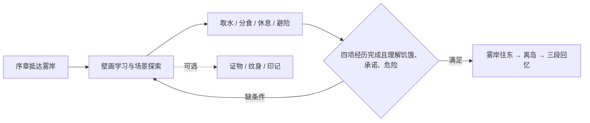

# 显示与游玩修复：2026-11-13

## 范围与结论

对照阿里云独立测试站，排查序章、雾岸、棚火、经堂前坪、木经堂、雾径和夜营。测试地址现固定为 **http://47.252.94.138/test/**；本轮线上核对的 revision 为 `ebdce7bca6bceea7010881529f65748666684299`，dirty 为 false。第一至三轮的显示与移动修复已在此版本部署；下文第四至七轮为后续主线与体验重构，需 Grok bot 再部署。分支为 `fix/snapshot-portability-and-gameplay`，PR #66。历史 review 目录不再作为当前版本判断依据。

旧站正常网络下请求可以全部成功，但画面仍不完整。因此问题不能仅归因于服务器漏传图片：素材、布局、加载时序都需要修复。

| 部分 | 确认的问题 | 本次处理 |
| --- | --- | --- |
| 资源与加载 | PNG 修好了但优先加载的 WebP 仍是旧图；其他场景加载结束时人物尚未准备好 | 使用完整的统一向导立绘；六个场景都等待建筑、道具和两名角色；失败可重试；等待期间暂停移动 |
| 背景与建筑 | 视口拉伸、放大过度；透明留白参与缩放；旧 CSS 擦掉建筑右侧；前景遮住主体 | 固定 16:9 世界坐标；缩小镜头倍率；根据 alpha 边界显示主体；去掉裁切与多余前景；重排六个场景 |
| 棚火木屋 | 原素材门口是整块平涂色；独立帘子重复叠加 | 用图像生成工具修复完整透明木屋，保留木结构风格，门口恢复室内深度；移除重复帘子 |
| 人物与向导 | 历史落地素材有残缺/黑剪影/不一致留白；脚底与道具深度不统一 | 采用完整披风向导并统一站立/跳跃可见高度；脚底清理和按地面位置排序在六个场景启用 |
| 雾径 | 人物在桥下或悬崖上行走 | 移动约束、到达点、热点和向导位置对齐木桥曲线 |
| 道具交互 | 点击区域集中在脚点，物体本身难点；前坪“多/少”受不可达位置影响 | 热点覆盖物体范围且至少 44px；保留走近后交互；前坪木牌可从台阶前操作 |
| 存档与构建 | 存储被禁用时白屏；测试依赖开发者机器目录和缺失原图 | 存储异常可恢复并提示；测试素材进入仓库；声明 Python 依赖并纳入 CI |

## 实际验证

- 第三轮为 90 个测试文件、619 项单元/组件/图片测试；第四轮新增主线门槛、提示、出口边界与壁画引导回归，该轮 93 个文件、629 项测试通过。内容检查、TypeScript 与生产构建通过。
- 独立 display-review 构建及其持久化模块隔离检查。
- Chromium 生产包鼠标/键盘通关：序章 → 28 词壁画 → 取水 → 睡眠 → 前坪多/少、拿取与分享 → 雾径危险 → 夜营证物 → 经堂印记与纹身 → 离岛三段回忆 → 刷新继续。预期剧情节点和三份证物均保留，未出现页面异常或 HTTP 错误响应。可复跑 `npm run test:browser`。
- 390×844 竖屏、844×390 横屏，无页面横向溢出；触屏点击移动正常。
- 禁用 `localStorage` 后仍能进入游戏、打开/关闭案卷，并显示未保存提示。
- 故意阻塞人物请求：界面保持加载、移动暂停；放行后人物完整出现。故意令木屋返回 404：显示重试，恢复请求后无需刷新即可继续。
- 六场景截图与浏览器计算样式核对，包括建筑没有渐变裁掉半边、雾径脚点落在桥面、人物与向导实际图像解码完成。此验证不覆盖所有设备及每种可选操作组合。

## 第二轮：线上验证后的操作与可读性优化

- 将装饰性罗盘替换为「路线」：列出当前场景出口，选择后沿原有移动逻辑走到出口；相机外的出口在手机上也能操作。靠近物件时显示底部交互按钮和对应图符，保留默认关闭教学义的规则。
- 原先菜单按钮获得焦点后，Enter/空格会被全局交互键拦截。现在原生按钮正常响应，E/F 仍可用于场景交互，文本输入不再触发移动。
- 摇杆只接收持有它的那根手指；其他手指抬起不打断移动。取消触摸、丢失指针捕获、窗口失焦、打开覆盖层后会清理移动状态。
- 减弱非雾岸场景的下缘黑色渐变和重复暗角，使人物脚边与低处道具更容易辨认；夜景仍保留其环境色。
- 每次生产构建输出 `version.json`（Git revision、dirty、构建时间）和 HTML revision 标记，以区分多个测试目录与缓存版本。
- 新增 `npm run test:controls`：真实手机视口中，验证所有 10 条场景连接、路线 Escape、底部交互、壁画学习、多指摇杆松手停止和横屏调整；菜单 Enter/空格也在真实浏览器核对。

## 第三轮：步态素材与移动路线

- 生成并接入 `src/assets/traveler/stride-atlas.png`：1448×1086 透明 PNG，三行分别为正面、向右侧面、背面，每行四个步态。沿用仓库角色的头发、长衣、手杖和配色；补充迈步、收腿和对侧迈步。左向复用侧面镜像。
- 保留原始图集，通过 CSS 裁切单元格；以身体轴和落地鞋底注册，避免宽衣摆改变人物中心。素材来源为本次图像生成及姿势修正，原有逐帧素材和像素审核记录保留。新图不使用旧鞋底清理遮罩。
- 首屏一次解码整张图集，再同时开放 12 个帧标识；切方向无需逐张请求。显示失败会清除整张图集的缓存并重试。
- 步频跟随按 16:9 换算后的实际地面位移；步幅与显示身高匹配。迈步淡化缩短为 45ms，转向为 110ms，斜向转向加入迟滞，起步即播放行走，停下即回站立。
- 同一输入强度在横、纵和斜向具有相同屏幕速度；加快起步和刹停。模拟测试和浏览器验证松手后的额外位移小于约十分之一个人物身高。
- 将进入石头、墙面时的强制位置校正替换为连续阻挡与沿边滑动，避免跨过障碍时突然落到下方。地面点击和路线出口通过障碍角点绕行；木桥使用桥面折线并限制单帧位移。
- 新增 `npm run test:movement`：生产包冷启动后用真实按键行走，检查四方向各四帧、图像解码、松手停止、原地站立，并保存实机截图、DOM 采样和视频。首次录制需要 `npx playwright install ffmpeg`。浏览器运行均用本地生产构建；新提交仍需部署后核对线上。

## 第四轮：主线逻辑、操作与可视化

### 主线规则

四项经历允许任意顺序完成，不强迫玩家按固定场景顺序走。壁画的具体、动作、关系、抽象层按原有条件开放；抽象词仍按内容依赖出现。证物不作为通关条件，延续开发文档的“可漏收”设计。旧版已经离岛的存档保留完成状态，不伪造它未做过的经历。

| 主线节点 | 词义前提 | 实际操作 | 完成记录 |
| --- | --- | --- | --- |
| 取水 | 水 | 雾岸走近水瓢，打开选择并选水符 | water |
| 休息 | 休息、火 | 棚火走近铺位并躺下 | sleep |
| 分食 | 给予、分享 | 前坪走近分食处并递出 | food |
| 避险 | 危险 | 雾径选择停步；选择前行不计完成 | danger |
| 离岛 | 饥饿、承诺、危险，且以上四项已完成 | 雾岸走近往东出口并交互 | depart、海图与回忆 |

这里的中文词义用于开发核对；游戏内教学义仍默认关闭。28 词不要求全部学完才离岛，判断的是上述必要条件。

### 线上复现与修复

| 检查项 | ebdce7b 线上实测 | 本轮修复 |
| --- | --- | --- |
| 主线闭环 | 只学 17 词并取水即可离岛，跳过分食、休息、避险 | 离岛检查四项实际经历及原有词义条件；失败说明缺哪一步、去哪里 |
| 当前目标 | 只有词数，无法知道真实离岛条件 | HUD「旅程 n/4」打开案卷清单，标明完成/待完成及下一步；完成章节后显示可重看回忆 |
| 向导提示 | 三级提示后切到另一刻符，仍指向上一题 | 选题、场景、层级与覆盖层改变时重置；旧存档的过期目标在下一次提示时纠正；复用提示使用当前复用目标 |
| 重复取水 | 已喝水再点水瓢，仍报告失败 | 显示已完成反馈，不重复增加进度 |
| 危险与余烬 | 危险分支没有清晰原因，夜营余烬点击没有响应 | 停步/前行给出对应反馈；余烬可查看，不额外授予证物或主线节点 |
| 壁画画面 | 原有壁画图片未使用；层级只有细线，完成后缺少下一步 | 恢复现有壁画背景，显示层级名称、进度、下一带与返回场景按钮，保留默认无教学义 |
| 手机壁画 | 抽象层的刻符和答案超出屏幕，向导遮住下部答案 | 页面内纵向滚动，向导进入正常排版；390×844 下全部 11 个抽象词可实际点击完成 |
| 反馈可读性 | 操作结果文字与底部按钮、案卷内容重叠；快速错/对/错可能保留旧效果 | 将结果文字移到按钮上方，打开菜单时隐藏；切换反馈先清理旧抖动与呼噜效果 |
| 休息后的移动 | 躺下期间选择路线，移动目标会逐帧被清掉 | 休息开始时停止旧移动，新选路线保留到起身后执行 |
| 出口边界 | 自动行走可能停在 `0.8999999999999999`，与出口 `0.9` 严格比较失败，导致到达后不换场景 | 加入仅覆盖浮点舍入误差的边界容差，并对四个方向验证；不扩大可见出口范围 |

浏览器检查 `npm run test:gameplay` 使用新存档与真实点击，不注入解锁状态，覆盖“学完全部词并取水仍不能跳过其他经历”、手机壁画全部答案、四项经历、休息期间选路线后起身出发、漏收可选证物仍可离岛、回忆结束后刷新继续。原有 `test:browser` 负责收集三份证物的完整路径，`test:controls` 负责手机路线与输入。

### 尚未完成的游戏性

- 当时上下两排仍是相同图符匹配；第五轮已替换为情景判断。
- 当时复用带只有一个答案；第五轮已增加情景题面、相近词干扰项和错题记录。
- 刷新保留场景与剧情进度，但不保存精确站位；角色回到该场景的默认落点。
- 因此本轮结论是主线条件与操作反馈更完整的可通关原型，不是已经完成游戏性打磨的首岛成品。

## 第五轮：整体开场与情景理解

本轮把“素材能显示、流程能走完”推进为有统一构图和明确探索意图的开场体验。

- **整体绘制雾岸**：背景、山水、石壁、泉池、漂木、门与路标处在同一幅画的透视和光线里。生产运行只加载这张约 320 KiB 的 WebP 与角色，不再把旧道具图叠上去。保留独立角色、热点和反馈层；历史分层渲染仍供 display-review 使用。
- **画面与操作对齐**：沙地行走范围调整到 y=0.62–0.88；东侧路石、泉池与漂木有与画面对应的阻挡范围，自动寻路绕行。五个物件的点击框、脚点、向导目标与出口同步校准。点击仍会先走近，再交互，不通过更大触发范围掩盖错位。
- **探索有目的**：左上显示当前章节、所在场景和随实际经历变化的一项行动目标。旅程清单仍可打开，完成饮水、休息、分享或避险时短暂显示经历确认。旧存档继续兼容。
- **世界有反馈**：地面点击显示目的落点；行走留下短暂脚印；物件回应时出现短促波纹。减少与场景无关的浮动道具效果，统一菜单、交互按钮和案卷的色彩与文字层级；减少动态效果设置下关闭装饰动画。
- **28 个词义情景**：生成五张 3×2 同画风图集，覆盖具体物、动作、关系和抽象词。图片按方形格完整显示，没有把答案刻符复制到题面；加载失败保留情景文字。
- **学习与理解分开**：学习先选择刻符，再从三幅情景中选择含义。干扰项优先使用容易混淆的意思，例如“给予 / 分享 / 拿取”，同时过滤未开放的词。复用改为看情景选 2–4 个已学刻符之一；不足两个已学词时不开放；答错记录在当前题目，正确才记熟。

新增 `npm run test:experience`：真实新存档下确认整体场景解码、旧道具不重复覆盖、五个交互区域、行走目的点、三幅情景题、复用至少两个答案、错题与记熟记录、手机画面无横向溢出。其余主线、触屏路线与完整证物流程仍使用已有浏览器检查。

验证结果：95 个测试文件、640 项测试通过；内容检查、TypeScript 与生产构建通过；独立 `vite.display-review.config.ts` 构建通过，持久化模块依赖列表为空。新开场/复用浏览器检查、手机十条路线和多指输入、四方向各四帧行走与刹停录屏均通过。

这轮完成的是统一开场和全词库情景理解的重构；其余五个探索场景、交互姿势、环境动效与声音还没有达到同等美术完成度。已有规则和实际经历是后续多步骤环境谜题的基础，不能把当前选择题当成已经完成全部游戏性设计。

## 第六轮：序章分镜与入岛衔接

序章保留“落水 → 猫叫与伸手 → 长卷裂符闪回 → 潮线相遇”四个剧情节点，重做为玩家自行推进的绘本分镜。

- 四幕统一使用雾岸的手绘色彩和笔触，潮线一幕使用实机场景作为构图参考。猫与旅人的比例统一；插画里不额外叠加另一只猫。
- 生成四张 1672×941 横幅与四张 1024×1536 竖幅，均压缩为 WebP。根据实际可用画幅选择完整构图，不裁掉救猫、手势或人物脚部。高度较小的手机和横屏仍使用横幅。素材说明与生成来源见 `src/assets/art/painted/README.md`。
- 重写四段文案，分离分镜标题、叙述和控制栏。玩家可以上一幕、空格/右方向键继续、左方向键回看、随时跳过；没有自动跳过文字或强制等待时间。尊重减少动态效果偏好。
- 下一张图解码后才切换图像和文字；慢加载保留前一幕。图片失败时明确提示、手动重试并自动恢复，初始加载失败也能跳过。横竖屏切换使用相同机制，过期请求不会覆盖当前分镜。
- 回看不会撤销证物，重看不会重复领取；跳过逐一应用原剧情转换，保证猫叫、裂符、相遇与第一份证物完整。保存结构未改变，中途刷新后可继续。
- 最后一幕预加载雾岸及人物，并提示“走近石壁，看看陌生刻痕”，与入岛后的实际目标相接。

新增 `npm run test:prologue`：真实 Chromium 验证四幕横/竖构图、故意延迟图片、故意请求失败与重试、键盘与触屏、中途续玩、回看证物不重复、390×844 / 320×568 / 844×390 布局、减少动态效果、跳过与雾岸衔接。`test:controls` 同时覆盖连续触屏推进后进入十条场景路线，防止点击判重误吞下一幕操作。

第六轮为带转场的交互分镜，当时猫叫仍沿用合成占位音效；第七轮增加实时动画和录音音景。其余章节的美术与玩法局限仍如上所述。

## 第七轮：绘本动画与声音（2026-11-14）

序章在保留八张完整横/竖构图的基础上，加入实时演出。默认仍由玩家推进；选择“连播”后按 9 / 10 / 9 / 10 秒播放四幕，再进入雾岸。

- **四幕分别运动**：风暴的轻微镜头浮动、雨线、海面涌动和近处水雾；救猫时减弱雨势与镜头摆动；裂符的短暂光线描绘、暖光与升起的金尘；晨岸的水光和远处薄雾。水面只在已标定的裸露区域采样位移，不扭曲人物、猫或手。镜头始终把完整构图留在画幅内，正文和按钮不晃动。
- **播放节奏统一**：暂停冻结画面与声音，重播本幕重新触发演出，跳过清理序章声部。加载图片和页面隐藏期间不累计播放时间；减少动态效果时保留静态分镜与声音。效果绘制上限 30 fps，Canvas 分辨率最多使用 1.5 倍设备像素比。
- **真正的环境素材**：引入经来源页核对的 CC0 猫叫、呼噜、风、雨和海浪录音，制作四段 16 秒循环环境声；记忆段另含原创合成的和声音色，裂符使用原创短促音效。七个 MP3 共约 828 KB，随游戏本地部署，不依赖外站播放。来源、作者、处理方式及原始文件哈希在 `src/assets/audio/`。
- **全局音量与静音**：标题、游戏设置可调音量，序章可直接静音。偏好使用独立存储键保存，不更改旧存档结构；存储或音频设备不可用时仍能游玩。共用音频总线有平滑音量变化与压缩器，避免声部切换时爆音。
- **音频生命周期**：音景淡入淡出，异步解码结束后检查场景是否还有效。暂停、隐藏、离开或快速切幕取消旧声部；猫叫每次演出只触发一次，暂停恢复不会重复叫。音频加载失败可重试，也会自动重试，图片和剧情照常推进。进入雾岸后转为安静水声，回标题关闭音景；游戏内成功反馈使用真实呼噜，离开界面时取消迟到的加载。

新增 `npm run test:cinematic`：使用真实 Web Audio 输出检查非静音信号、静音、暂停、后台可见性、减少动态效果、猫叫次数、失败重试、快速离开无残留声部、完整实时连播；保存带实际游戏声音的 `artifacts/browser-cinematic/prologue-performance.mp4`。另以原序章与触屏检查覆盖图像恢复、续玩、手机构图及场景路线。

验证结果：98 个测试文件、663 项测试通过，TypeScript 与生产构建通过；实时声画、原序章恢复、手机十条路线及壁画学习/复用浏览器检查通过。实机录制为 1280×800 H.264/AAC，约 40 秒；录制输出峰值约 -2.87 dBFS，无削顶。

当前属于实时绘本动画：人物主体仍是绘制姿态，尚未制作逐关节表演、口型或完整影视级角色动画。其余探索场景的环境音与动作音还未全部制作。此次声音已不再仅靠原来的正弦提示音，但也没有宣称完成全游戏配乐。

## 给 Grok bot 的部署说明

1. 在独立构建目录获取 `fix/snapshot-portability-and-gameplay` 的最新提交，并记录 `git rev-parse HEAD`。不要继续构建旧的 `d1b1617`。
2. Node.js 22+：运行 `npm ci`、`npm run build`。普通生产构建已默认包含显示修复，不需要 `VITE_SHORE_DEPLOY_ORIGIN` 或视觉实验查询参数。
3. 将整个 `dist/` 内容部署至固定独立测试站 `/test/`；入口用 `index.html`，不要用 `display-review.html`。`base: './'` 支持当前的子路径。
4. 同一次构建的 HTML、JS、CSS、字体、图片必须一起发布。建议先发布到新目录，再切换测试站；保留上一版供回退。不要只更新入口文件或覆盖部分 assets。
5. HTML 使用重新验证缓存策略（如 `Cache-Control: no-cache`）；带哈希文件名的 assets 可长期缓存。若前面有 CDN，刷新测试入口的缓存。
6. 检查测试站资源无 404、浏览器无错误，并用新无痕会话运行 `ODYSSEY_URL=http://47.252.94.138/test/ npm run test:browser`。测试只写该自动化会话的本地存档。
7. 获取 `http://47.252.94.138/test/version.json`，确认 `revision` 等于部署提交且 `dirty` 为 `false`；再运行同地址的 `npm run test:cinematic`、`npm run test:prologue`、`npm run test:gameplay`、`npm run test:experience`、`npm run test:controls` 与 `npm run test:movement`。旧的 `d1b1617` 和 `641841a` 产物没有此版本文件。

不需要删除现有玩家存档。本次没有改变存档版本或持久化字段。

## 后续美术工作

当前修复保证已实现章节的加载、图层与交互可运行；没有重做全部动画。向导各站立状态暂时共用完整披风立绘，保留移动跳跃；人物行走已换成新四帧图集，仍属于简化逐帧动画；站立、互动和向导的完整姿势动画，以及更统一的场景美术仍可继续细化。五岛后续章节、最终对峙与原生手机工程仍未实现。

## 第八轮：v0.1 首章发布候选（2026-11-14）

这轮交付范围固定为序章与东巴岛，不把后续岛屿占位当作完成内容。序章增加图像空间关节动画；旅者新增伸手、饮水、坐下休息十二帧透明素材。动作使用真实经过时间，修复低帧率时动作倒计时结束但姿势停在首帧的问题；再次互动会重启动作，移动会打断。

营地、前坪、经堂、雾径、夜营改用完整统一绘景，首屏按单张环境、旅者与伙伴解码，减少零散素材加载。经堂与夜营的可互动落点通过 `playAt` 独立记录，内容校验和实际可走范围保持一致。经堂北墙及夜营桌案、火塘、披风石台不再允许人物穿行。

补齐场景音景、首章完成后的探索入口、存档导出/校验/恢复、新游戏确认及小屏操作说明。标题页显示 v0.1.0；`version.json` 带版本、范围、提交和脏工作区标记。`npm run release:pack` 只接受干净提交，生成可直接放入 `/test/` 的静态 ZIP、逐文件校验表与包校验值。详见 [v0.1 发布说明](releases/v0.1.md)。

自动测试：100 个文件 / 669 项通过；新增浏览器脚本 `test:release` 覆盖独立肢体运动、暂停、新游戏取消、备份、无效导入、恢复、四帧饮水与休息、手机设置和无 WebGL 回退。现有完整主线、手机路线、移动、语义选择、序章与音景回归继续保留。

## 第九轮：v0.1.1 声音恢复与切帧修复（2026-11-14）

用户报告线上无声、行走偶发一帧变大。核对 `/test/version.json` 为 v0.1.0 / c8cf1d5；音频资源返回 200，干净 Chromium 桌面/触屏会话可检测到输出，因此不能把用户的无声直接归因于缺文件，也不能据此认定实体设备播放正常。

音频修复：未解锁、暂停和音量为零时不再显示“声音开”；启用操作恢复有效音量，音量滑条解除静音。新增应用级中断恢复和 pageshow/visibilitychange 恢复，游戏操作可再次解锁；原有静音选择仍保留。支持 Audio Session 的浏览器请求 playback 路由。场景 MP3 加载失败有可见重试入口，标题/设置新增不依赖下载文件的两声试听。序章使用原有页内音频按钮，避免浮动提示遮住手机“下一幕”。

动作修复：原生产采样中出现过 walk → idle → walk 的单帧待机插入；位置更新短暂落后于表现 RAF 时现在保持原步态，但不推进虚假步幅，释放输入仍立即停止，持续碰壁也会停步。图集显示不再把帧名 fragment 写入 img.src，十二帧共用同一个已解码 URL。图集与独立待机图切换时分离原生图片节点，防止前一个位图沿用新裁剪比例；当前帧与淡出帧有明确的同尺寸容器。

浏览器专项 `test:audio` 使用必须用户手势的自动播放策略，验证真实音频输出、中断恢复、后台恢复、触屏启用、静音重载、零音量、下载失败时试听及重试，未发现页面异常。`test:movement` 增加每帧实际位图、容器和裁剪比例检查及待机闪帧检查，四方向全部通过。`test:cinematic` 的完整序章、实际音频录制、暂停/静音/后台/重试/跳过清理通过。设备静音开关、蓝牙路由和实体 Safari 扬声器尚需部署后实机复核。

最终本地验证：101 个测试文件 / 677 项通过（含内容校验），TypeScript 与生产构建通过；`test:release` 的肢体动作、饮水/休息四帧、存档恢复、手机设置及无 WebGL 回退通过。

## 第十轮：v0.1.2 动作拟音、环境细节与主题配乐（2026-11-14）

按声音补全方案扩充为 52 段内置 MP3，合计 4.82 MB。脚步、衣料、饮水、液体晃动、放下物件、纸张、鸟鸣、火声与虫鸣使用核实过来源的 CC0 录音；三段配乐和学习短音由项目脚本合成。新增七组来源的下载地址、作者、许可和 SHA-256 记在 `src/assets/audio/gameplay-sources.json`；处理脚本、完整鸣谢与打包鸣谢同时保留。

- 沙地、石地、木地板共 16 个脚步变体，跟随实际显示的第 0/2 落脚帧，避免连续重复。持续碰壁、停止移动、菜单、换场景或隐藏页面会停声；冷加载错过落脚帧不补播。衣料轻响随步态出现。
- 饮水的抬杯、吞咽、放杯与坐下休息分别跟随动作帧；重复操作先等新动作起始帧，防止把上一轮末帧的声音带入下一轮。拒绝交互不播放成功拿取音。
- 刻符选择、答对、答错、学会新字、拿到证物、翻页和首次完成生存经历采用不同反馈。移除所有成功操作都响呼噜的旧逻辑，保留漂木相遇呼噜和主动求助猫叫。恢复同一旅程存档也不重放获得奖励的声音。
- 五个场景采用 48 秒环境床声，前坪独立处理远处海浪，棚火加入真实火声，夜营加入虫鸣。鸟声与木响分散触发，探索不持续铺音乐；标题、回忆和首章完成采用三种共享旋律动机的简短编配。
- 主音量、动作与反馈、环境、音乐各自保存。标题分项设置可展开，避免挤占开场。音频解码缓存限制为 48 MiB；已结束声部释放节点和引用，取消待加载或延迟触发的声音不会在恢复后集中播放。

验证：105 个测试文件 / 692 项通过（含内容校验）。`test:foley` 在真实 Web Audio 中核对三种地面、落脚帧、停步/菜单/碰壁、饮水/坐下、独立混音与保存、慢加载和手机设置；`test:audio` 的中断恢复、后台返回、静音、离线试听和重试通过；`test:cinematic` 的完整序章声画、暂停、重试和转标题配乐通过；`test:release` 的肢体动作、四帧交互、存档恢复和手机设置通过。实际游戏混音与画面录制保存在 `artifacts/browser-foley/gameplay-sound-demo.mp4`。

这些验证覆盖信号输出、触发时机和资源生命周期，不等于完成实体设备扬声器试听。部署后仍需用户在实际设备确认音量、音色与设备路由。版本与部署步骤见 [v0.1 发布说明](releases/v0.1.md)。
